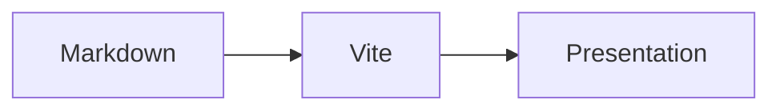

# AyaExpTech Presen'it!

Markdownから整ったプレゼンスライドを作るViteプラグインです。
Markdownにコメント形式の指示を少し加えるだけで、改ページ・段組み・段階表示ができます。
ライブプレビュー、複数デッキの静的ビルド、発表者ビュー、ブラウザ印刷によるPDF保存に対応しています。

- **書く**：Markdown、コードのハイライト、数式、Mermaidの図、GitHub形式のアラート。
- **整える**：カラム、中央揃え、明暗のテーマ、アクセントカラー、フォント、スライドサイズ。
- **発表する**：段階表示（Reveal）、スライド一覧、発表者ノート、タイマー、レーザー、ブラックアウト。
- **共有する**：Viteで静的サイトとしてビルドし、ブラウザからPDFとして保存。

> [!NOTE]
> このツールは、そのほとんどがAIによって実装された、いわゆるVibe-Codingプロダクトです。  
> AIへの指示を行った私(綾坂こと)自身が使用しているためある程度品質については保証しますが、コードベース管理のほとんどをAIエージェントに委任しているプロダクトであることには留意してください。  
> なお、使用モデルはGPT-6.1 Sol (Codex)・Claude Opus 5.5 (Claude Code)です。

## License

copyright (c) 2026- Ayasaka-Koto(AyaExpTech).

Released under the [MIT License](LICENSE).

---

## Presen'it!の使い方

### 目次

- [はじめる](#はじめる)
- [スライドを書く](#スライドを書く)
- [デッキ全体を設定する](#デッキ全体を設定する)
- [サイトで公開する](#サイトで公開する)
- [発表する](#発表する)
- [PDFとして保存する](#pdfとして保存する)
- [デッキ一覧を取得する](#デッキ一覧を取得する)
- [AIにスライド作成を頼む](#aiにスライド作成を頼む)
- [v1から移行する](#v1から移行する)
- [このリポジトリで開発する](#このリポジトリで開発する)

### はじめる

#### インストールと設定

Node.js 22.18.0以上とVite 8が必要です。
JSRのパッケージ`@ayaexptech/presen-it`を、Viteプロジェクトに追加してください。

```sh
pnpm add -D jsr:@ayaexptech/presen-it
```

Vite+を使う場合は`vp add -D jsr:@ayaexptech/presen-it`でも追加できます。
新しいプロジェクトでVite自体がまだ入っていない場合は、`pnpm add -D vite`で追加してください。

```ts
// vite.config.ts
import { defineConfig } from "vite";
import presenit from "@ayaexptech/presen-it";

export default defineConfig({
    plugins: [presenit()],
});
```

既定では`src/**/index.md`が対象です。たとえば、次の構成でスライドを作れます。
1つのMarkdownファイルが、複数ページを含む1つの「デッキ」になります。

```text
vite.config.ts
src/
  slides/
    example/
      index.md
      assets/       # 画像など。必要な場合のみ
```

#### 最初のスライド

`src/slides/example/index.md`に、次の内容を書いてください。

````md
---
title: はじめてのPresen'it!
description: Markdownからプレゼンスライドを作る
footer: 綾坂こと
---

<!-- presen-it! slide-break (center-x=true) -->

# Markdownから、発表まで。

いつものエディターでスライドを書く。

<!-- 最初に自己紹介をします。このコメントは発表者ノートになります。 -->

<!-- presen-it! slide-break -->

## 左に説明、右にコード

- Markdownで本文を書く
- コメントでレイアウトを指定する

<!-- presen-it! column-break -->

```ts
const message = "Hello, slides!";
console.log(message);
```

<!-- presen-it! slide-break -->

## 少しずつ、伝える

この文章は最初から見えます。

<!-- presen-it! reveal (at=1) -->

この文章は「次へ」を1回押すと現れます。
````

Viteの開発サーバーを起動し、表示されたアドレスの`/slides/example/`を開きます。
Markdownや参照画像を編集するとプレビューが更新され、表示中のページとRevealの段階を保持します。
スライド用のHTMLやJavaScriptのエントリを自分で用意する必要はありません。

```sh
pnpm exec vite
```

#### 対象ファイルとURLを変える

`presenit()`には、次のオプションを渡せます。

| オプション | 既定値                | 意味                                    |
| ---------- | --------------------- | --------------------------------------- |
| `includes` | `["src/**/index.md"]` | 対象のMarkdownを選ぶglobパターンの配列  |
| `excludes` | `[]`                  | 対象から除外するglobパターンの配列      |
| `root`     | `"src"`               | デッキのURLを組み立てる基準ディレクトリ |

いずれも**Viteのプロジェクトルート**からの相対パスです。
プラグインの`root`は、Vite自体の`root`とは別の設定です。
`node_modules`・`dist`・`.git`以下は常に除外されます。

```ts
presenit({
    includes: ["src/**/*.md"],
    excludes: ["src/**/draft/**"],
    root: "src",
});
```

URLは、プラグインの`root`からの相対パスから`.md`を取り除き、ファイル名が`index`ならそれも取り除いて、
末尾に`/`を付けたものです。ビルド時には、そのディレクトリの`index.html`を生成します。
上の設定なら、次のようになります（Viteの`base`が`"/"`の場合）。

| Markdown                      | 閲覧URL            | ビルド先（既定の`dist/`内） |
| ----------------------------- | ------------------ | --------------------------- |
| `src/slides/example/index.md` | `/slides/example/` | `slides/example/index.html` |
| `src/slides/team.md`          | `/slides/team/`    | `slides/team/index.html`    |
| `src/index.md`                | `/`                | `index.html`                |

対象ファイルがプラグインの`root`の外にある場合や、同じURLになるデッキがある場合はエラーになります。
URLの重複は大文字・小文字を区別せずに判定します。
生成先と同じ場所に既存のHTML（`public/`内も含む）がある場合もエラーになります。
別のURLであれば、通常のViteのHTMLページとスライドを同じプロジェクトに置けます。

### スライドを書く

#### 改ページと見出し

`<!-- presen-it! slide-break -->`を、ブロックの間に単独行で置くと改ページします。
最初の改ページより前が1ページ目になります。
見出しやMarkdownの水平線だけでは改ページしません。

各ページの最初のブロックが`## 見出し`なら、カラムの上に共通のページ見出しとして表示します。
`# 見出し`や、本文の途中にある`## 見出し`は、本文内に表示します。

```md
# 表紙のタイトル

表紙の本文。

<!-- presen-it! slide-break -->

## 2ページ目の見出し

2ページ目の本文。
```

ファイルの先頭（frontmatterがあればその直後）の`slide-break`は、
空ページを作らず、1ページ目の配置を指定します。
本文の量に応じた自動改ページは行いません。
収まらないときはページを分けるか、文章量や`fontSize`を調整してください。

#### カラムと配置

`<!-- presen-it! column-break -->`を置くと、それ以降の本文を右隣のカラムに分けます。
カラムは等幅で横に並び、空のカラムは取り除かれます。4カラム以上では警告が出ます。

```md
<!-- presen-it! slide-break (center-x=true) -->

## 2つの図を比較する


<!-- presen-it! column-break (center-y=false) -->


```

`slide-break`と`column-break`には、配置のオプションを付けられます。

| オプション | 既定値  | 意味                                                  |
| ---------- | ------- | ----------------------------------------------------- |
| `center-x` | `false` | `true`なら本文を水平方向に中央揃え                    |
| `center-y` | `true`  | `true`なら本文を垂直方向に中央揃え、`false`なら上揃え |

`slide-break`の指定がページ内のカラムに適用され、
`column-break`の指定は**その指示で始まるカラム**の配置を上書きします。
複数のオプションは`(center-x=true&center-y=false)`のように`&`でつなぎ、
`=`や`&`の前後に空白を入れないでください。

ページ先頭の`##`を共通見出しにせず本文に入れたい場合は、
`slide-break`の直後に`column-break`を置いてから書きます。

#### 段階表示（Reveal）

`reveal`は、同じページ内で「次へ」を何回押したときに内容を表示するかを指定します。
`at=0`が最初の状態、`at=1`が1回目、`at=2`が2回目です。

```md
最初から見える文章。

<!-- presen-it! reveal (at=1) -->

1回目で現れる文章。

<!-- presen-it! reveal (at=2) -->

2回目で現れる文章。

<!-- presen-it! reveal -->

この文章は最初から見えます。
```

- 指定は**後ろに続く内容**に適用され、次の`reveal`まで有効です。
- カラムをまたいでも指定は続きます。改ページすると`at=0`に戻ります。
- `at`は非負整数です。省略した`<!-- presen-it! reveal -->`は`at=0`を指定します。
- 番号を飛ばすと、その段階は何も変化しない操作になります。番号を戻した指定も可能です。
- 共通のページ見出しになった`##`は、常に表示されます。
- 「前へ」では段階を戻り、前のページに戻るときはそのページの最終段階を表示します。
- スライド一覧とPDFでは、すべての段階を表示します。発表者ビューの「次の表示」は、次の段階をプレビューします。

`reveal`は、リスト項目の末尾や文章の途中、強調の中にも置けます。
行末に置いた指示は、その項目ではなく**次の内容**から効きます。

```md
- 最初から見える項目<!-- presen-it! reveal (at=1) -->
- 1回目で現れる項目<!-- presen-it! reveal (at=2) -->
- 2回目で現れる項目

この部分も2回目。<!-- presen-it! reveal (at=3) -->ここからは3回目。
```

ブロックに適用するときは、指示の前後に空行を入れて単独行にしてください。
行頭のHTMLコメントと同じ行に本文を書くと、Markdownがその行をHTMLブロックとして扱い、
意図どおりに表示されません。
不明なコマンドや不正なオプションは、警告を出してその指示全体を無視します。

#### 発表者ノート

各ページの末尾に、通常のHTMLコメントを独立したブロックとして置くと、発表者ノートになります。
ノートは発表者ビューに表示され、投影画面やPDFには表示されません。

```md
## 結論

スライドに表示する本文。

<!--
ここで実演に切り替える。
時間がなければ補足は省略する。
-->

<!-- presen-it! slide-break -->
```

ノートは最後のカラムの末尾に置いてください。途中のコメントはノートとして扱われません。
ノートの内容自体は生成されたHTMLに含まれるため、公開するデッキには公開できる内容を書いてください。

#### Markdown・コード・数式・図

通常の見出し、箇条書き、引用、リンク、画像に加え、次の記法に対応しています。

| 内容                         | 書き方・動作                                                       |
| ---------------------------- | ------------------------------------------------------------------ |
| 表・取り消し線・タスクリスト | GitHub Flavored Markdown。チェックボックスは閲覧専用               |
| コード                       | 言語名付きのコードフェンスをShikiでハイライト                      |
| インライン数式               | `$E = mc^2$`をKaTeXで描画                                          |
| 独立した数式                 | `$$`で囲むブロックをKaTeXで描画                                    |
| Mermaid                      | `mermaid`のコードフェンスをbeautiful-mermaidでSVGに変換            |
| アラート                     | `NOTE`・`TIP`・`IMPORTANT`・`WARNING`・`CAUTION`をラベル付きで表示 |

````md
```ts
const answer: number = 42;
```

$$
E = mc^2
$$



> [!TIP]
> Oキーでスライド一覧を開けます。
````

Mermaidの対応範囲はbeautiful-mermaidに従います。図に変換できない場合はコードとして表示します。
生のHTMLは、既定では実行せず文字列として表示します。
意図してHTMLを埋め込む場合は、frontmatterに`rawHTML: true`を指定してください。
コメント形式の指示と発表者ノートは、`rawHTML: false`のまま使えます。

#### 画像と別デッキへのリンク

画像の相対パスは、Markdownファイルの場所を基準に解決します。
画像を同じディレクトリの`assets/`以下に置くと、デッキ単位で管理できます。

```md


[別のデッキを開く](../team/index.md)
```

対象に含まれる別のMarkdownへの相対リンクは、そのデッキの閲覧URLに変換します。
`../team/index.md#2`のようにページ番号を付けることもできます。
外部URLはそのまま参照できます。同じデッキのページへは、`#2`のようにページ番号でリンクできます。
`public/`内の画像も、Viteの通常の規約どおりに参照できます。
存在しない相対画像を参照するとエラーになります。

### デッキ全体を設定する

ファイル先頭の`---`で囲んだYAML（frontmatter）で、デッキ全体を設定します。
省略した項目には既定値が使われます。

```yaml
---
title: 今日の発表
description: 発表内容の短い説明
theme: dark
hue: 280
fontFamily:
    sans: [M PLUS 1, system-ui, sans-serif]
    mono: [JetBrains Mono, ui-monospace, monospace]
pageTransition:
    type: scroll
    duration: 0.2
footer: 綾坂こと / AyaExpTech
---
```

| キー                      | 既定値                                     | 意味                                                                     |
| ------------------------- | ------------------------------------------ | ------------------------------------------------------------------------ |
| `title`                   | `""`                                       | 閲覧ページの`<title>`と`og:title`。空なら`AXT Presen'it! — <route>`      |
| `description`             | `""`                                       | 設定時のみmeta descriptionと`og:description`に出力                       |
| `theme`                   | `light`                                    | `light`または`dark`                                                      |
| `hue`                     | `210`                                      | アクセントカラーの色相。360で循環（例：`370`は`10`）                     |
| `width` / `height`        | `1920` / `1080`                            | スライドの幅・高さ（px、正の数）                                         |
| `fontSize`                | `32`                                       | 基準フォントサイズ（px、正の数）                                         |
| `fontFamily.sans`         | `"M PLUS 1", system-ui, sans-serif`        | 本文用フォント                                                           |
| `fontFamily.mono`         | `"M PLUS 1 Code", ui-monospace, monospace` | コード用フォント                                                         |
| `pageTransition.type`     | `fade`                                     | ページ切り替え：`none`・`fade`・`scroll`                                 |
| `pageTransition.duration` | `0.2`                                      | ページ切り替えの秒数。`0`で即時切り替え                                  |
| `animation.duration`      | `0.3`                                      | Revealのフェードの秒数。`0`で即時表示                                    |
| `rawHTML`                 | `false`                                    | `true`で生のHTMLを描画                                                   |
| `break`                   | `soft`                                     | `soft`は段落内の単改行を改行として表示。`hard`は通常のMarkdownと同じ扱い |
| `footer`                  | `""`                                       | 全ページの左下に表示するテキスト。空なら非表示                           |

`title`は閲覧ページの情報です。表紙に表示する見出しは、本文に`# 今日の発表`のように書いてください。
たとえば`/slides/example/`で`title`が未設定なら、閲覧ページのタイトルは`AXT Presen'it! — /slides/example/`です。

`fontFamily.sans`と`fontFamily.mono`は、CSSの`font-family`文字列か、フォント名の配列を受け取ります。
配列なら、空白を含むフォント名の引用符を自分で組み立てる必要がありません。
名前付きフォントはGoogle Fontsからの取得を試み、端末にあるフォントが優先されます。
通信せずに表示したい場合は、`[system-ui, sans-serif]`や`[ui-monospace, monospace]`などの総称フォントを指定できます。

アニメーションの秒数は0以上です。端末の「視差効果を減らす」設定ではアニメーションを抑制し、印刷時には無効になります。
型や値が不正な項目は、警告を出して既定値に戻します。
独自のキーはスライドの表示には使いませんが、[デッキ一覧](#デッキ一覧を取得する)の`frontmatter`から取得できます。

### サイトで公開する

Viteの通常のコマンドで、対象のすべてのデッキをまとめてビルドします。

```sh
pnpm exec vite build
pnpm exec vite preview
```

既定の出力先は`dist/`です。HTML・JavaScript・CSS・参照画像などを含む出力ディレクトリ全体を、
GitHub Pagesなどの静的ホスティングに配置してください。
`/slides/example/`に対して`slides/example/index.html`を返せるホスティングで利用できます。

サブディレクトリで公開する場合は、Viteの`base`を設定します。
たとえば次の設定では、デッキのURLは`/my-talks/slides/example/`になります。

```ts
export default defineConfig({
    base: "/my-talks/",
    plugins: [presenit()],
});
```

`base: "./"`による相対パスでのビルドにも対応しています。
通常の`index.html`がある場合は、スライドと一緒にビルドされるため、デッキの一覧ページも作れます。
Presen'it!はクライアント向けのHTMLビルド用で、ViteのライブラリモードとSSRビルドには対応していません。

### 発表する

#### 投影画面と操作バー

閲覧画面（Viewer）はスライドの縦横比を保ってウィンドウいっぱいに表示します。
操作バーは普段は隠れ、画面下部にマウスを近づける、Tabキーでフォーカスを移す、
タッチ端末でスライドをタップする、といった操作で現れます。

操作バーには、前へ・ページ番号・次へ・スライド一覧・レーザー・フルスクリーン・メニューがあります。
ボタンにマウスを重ねると、名前とショートカットが表示されます。
ページ番号の下の点はRevealの進行状況で、段階が多い場合は数値で表示します。
周囲の背景や操作バーもデッキの`theme`・`hue`に合わせた配色になります。

スライド一覧（Overview）では、すべてのRevealを表示したサムネイルからページを選べます。
タッチ操作では左右のスワイプで前後に移動します。

#### 発表者ビュー

メニューの「発表者ビューを開く」、またはPキーで、別タブに発表者ビューを開きます。
元のタブを投影し、発表者ビューを手元の画面に置いて使えます。

発表者ビューには、現在のスライド、次の表示、経過時間、発表者ノートが表示されます。
Revealの途中なら「次の表示」は同じページの次の段階を、それ以外では次のページを表示します。
操作バーは常に表示されます。

投影画面と発表者ビューのページ・Reveal・ブラックアウト・レーザーは双方向に同期します。
レーザーを有効にしてスライド上でポインターを動かすと、その位置も共有します。
ブラックアウトは投影画面を黒くし、発表者ビューは表示したままにします。

同期にはBroadcastChannelを使うため、**同じブラウザ・同じオリジンで同じデッキ**を開いてください。
別の端末にネットワーク経由で同期する機能ではありません。
URLに`?presenter`を付けても、発表者ビューを直接開けます。

#### キーボードとURL

| キー                         | 操作                                                                                   |
| ---------------------------- | -------------------------------------------------------------------------------------- |
| → / Space / Enter / PageDown | 次へ。ページ内のRevealを進めてから次のページへ                                         |
| ← / PageUp                   | 前へ。Revealを戻してから前のページへ                                                   |
| Home / End                   | 最初／最後のページへ移動（そのページの最初の段階を表示）                               |
| O                            | スライド一覧を開く                                                                     |
| P                            | 発表者ビューを別タブで開く                                                             |
| F                            | フルスクリーンを切り替える                                                             |
| L                            | レーザーを切り替える                                                                   |
| B / .                        | ブラックアウトを切り替える                                                             |
| T                            | 発表者ビューのタイマーを一時停止／再開する                                             |
| R                            | 発表者ビューのタイマーをリセットする                                                   |
| Esc                          | ブラックアウトの解除、開いた一覧やメニューを閉じる、キーボードで表示した操作バーを隠す |

PageUp・PageDown・`.`を送信するプレゼンリモコンでも操作できます。
ブラックアウト中は、黒い画面をクリックしても解除できます。
フルスクリーンが制限されている場合は、ブラウザのメニューから操作してください。

URLの`#N`は1始まりのページ番号です。`/slides/example/#3`なら3ページ目を開きます。
Revealの段階はURLには入りません。

### PDFとして保存する

1. 操作バーのメニュー（︙）から「PDFとして保存」を選びます。
2. ブラウザの印刷画面で、送信先に「PDFに保存」を選びます。
3. 余白なし・倍率100%・ヘッダーとフッターなしを指定し、必要に応じて背景の印刷を有効にして保存します。

メニューからの印刷はフォントと画像の読み込みを待ってから始まります。
すべてのRevealを表示し、1スライドを1ページとして出力します。
Viewerの操作UIと発表者ノートは入りません。
ページ寸法はfrontmatterの`width`・`height`に従います。

PDFはブラウザの印刷機能で保存します。`vite build`でPDFが自動生成されるわけではありません。
PDF保存のために、ブラウザ自動操作ライブラリをプロジェクトに追加する必要はありません。

### デッキ一覧を取得する

一覧ページを作りたい場合は、Presen'it!を設定したViteプロジェクト内で、次のモジュールを使えます。

```ts
import { decks, type PresenitDeck } from "@ayaexptech/presen-it/decks";

for (const deck of decks) {
    console.log(deck.title, deck.url, deck.slideCount);
}
```

`decks`の型は`readonly PresenitDeck[]`で、各デッキには次の値が入ります。

| プロパティ         | 型                                  | 内容                                                                |
| ------------------ | ----------------------------------- | ------------------------------------------------------------------- |
| `url`              | `string`                            | Viteの`base`を含む閲覧URL。末尾は`/`                                |
| `route`            | `string`                            | `base`を除いたURL（例：`/slides/example/`）。一意なキーとして使える |
| `source`           | `string`                            | ViteのプロジェクトルートからのMarkdownの相対パス                    |
| `title`            | `string`                            | Viewerの`<title>`と同じ値。未設定時の代替タイトルも反映             |
| `description`      | `string`                            | frontmatterの`description`。未設定なら空文字列                      |
| `slideCount`       | `number`                            | スライドのページ数                                                  |
| `theme`            | `"light" \| "dark"`                 | 正規化済みのテーマ                                                  |
| `hue`              | `number`                            | 正規化済みの色相（0以上360未満）                                    |
| `width` / `height` | `number`                            | スライドの幅・高さ（px）                                            |
| `frontmatter`      | `Readonly<Record<string, unknown>>` | 独自キーを含む、記述されたfrontmatter（JSON互換値）                 |

- 並び順はMarkdownのパス順です。必要なら利用側で並べ替えてください。
- 値はViewerと同じパーサーで読み取ります。`date`や`tags`などの独自キーも一覧に利用できます。
- `base: "./"`のビルドでは、`url`はバンドルされたJavaScriptの位置から解決した完全なURLになります。
- 開発中はMarkdownの追加・削除で再読み込みします。編集時はメタデータが変わった場合に、このモジュールを使うページを更新します（`import.meta.hot.accept`でも受け取れます）。
- 全デッキの`frontmatter`が利用側のJavaScriptに含まれます。公開できる値を使ってください。
- このモジュールはプラグインが生成します。プラグインを使わない環境で直接実行するとエラーになります。

同じ内容を`virtual:presenit/decks`から取得することもできます。
型定義が必要な場合は、パッケージの`@ayaexptech/presen-it/decks`を使ってください。
[examples/slides](./examples/slides/)の`index.html`と`src/main.ts`が一覧ページの実装例です。

### AIにスライド作成を頼む

AIエージェント向けの短い英語ガイドを、[skills/create-slides-using-presen-it/SKILL.md](./skills/create-slides-using-presen-it/SKILL.md)に用意しています。
Presen'it!でのスライド作成を依頼するときに読み込ませてください。
導入・記法・設定・確認に必要な情報をまとめています。

[skills](https://github.com/vercel-labs/skills) CLIからもインストールできます。グローバルインストールする場合は`-g`オプションを追加してください。

```sh
npx skills add AXT-Studio/presen-it --skill create-slides-using-presen-it       # npm
pnpm dlx skills add AXT-Studio/presen-it --skill create-slides-using-presen-it  # pnpm
vp dlx skills add AXT-Studio/presen-it --skill create-slides-using-presen-it    # Vite+
```

### v1から移行する

- パッケージはnpmの`@ayaexptech/presenit`から、JSRの`@ayaexptech/presen-it`に変わりました。
- `presenit init/dev/build/export`は廃止しました。Markdownを自分で作成し、Viteの設定とコマンドを使ってください。
- `src/<slug>/slide.md`という配置は必須ではありません。旧ファイルを使い続ける場合は、`includes: ["src/**/slide.md"]`などで対象に含められます。
- 既存のfrontmatter・コメント形式の指示・Markdown拡張の意味と既定値は維持しています。
- 未設定時の閲覧ページのタイトルは`AXT Presen'it! — <route>`です。出力URLとViewerの操作部・内部APIは変更しています。
- PDFの出力は、Viewerのメニューからブラウザの印刷機能を使います。

### このリポジトリで開発する

```sh
pnpm install
pnpm build
pnpm dev
```

サンプルのデッキは`/slides/example/`と`/slides/team/`、一覧ページは`/`です。
`pnpm build:example`でサンプルを静的ビルドし、`pnpm preview`で確認できます。

| コマンド                | 内容                                                       |
| ----------------------- | ---------------------------------------------------------- |
| `pnpm check`            | フォーマット・Lint・型検査・ユニットテスト                 |
| `pnpm test:integration` | ビルドしたパッケージを空のプロジェクトに導入して結合テスト |
| `pnpm check:jsr`        | JSR公開のドライラン                                        |

`pnpm build`は、ViewerのJS・CSSを文字列として持つ`src/generated/viewer.ts`を生成し、
プラグインのJavaScriptと型定義を`dist/`に出力します。
`src/generated/viewer.ts`はコミット対象です。JSR利用者がViewerを別途ビルドする必要はありません。
結合テストにはChromeまたはChromiumが必要です。自動検出できない場合は`CHROME_PATH`を指定してください。
