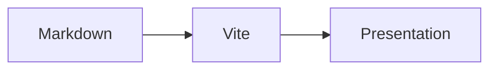

<!-- presen-it! slide-break (center-x=true) -->

# Markdownから、発表まで。

いつものViteプロジェクトでスライドを書く。

<!-- Speaker notes: 最初に自己紹介をします。 -->

<!-- presen-it! slide-break -->

## 少しずつ、伝える

最初から見える文章です。

<!-- presen-it! reveal (at=1) -->

- 一回目のクリックで表示

<!-- presen-it! reveal (at=2) -->

- 二回目のクリックで表示

<!-- 次の段階を確認しながら説明する。 -->

<!-- presen-it! slide-break -->

## 普通のMarkdownも、そのまま

> [!TIP]
> Oで全体を確認し、Pで発表者ビューを開けます。

```ts
const greeting: string = "Hello, slides!";
```

<!-- presen-it! column-break -->

$$
E = mc^2
$$


